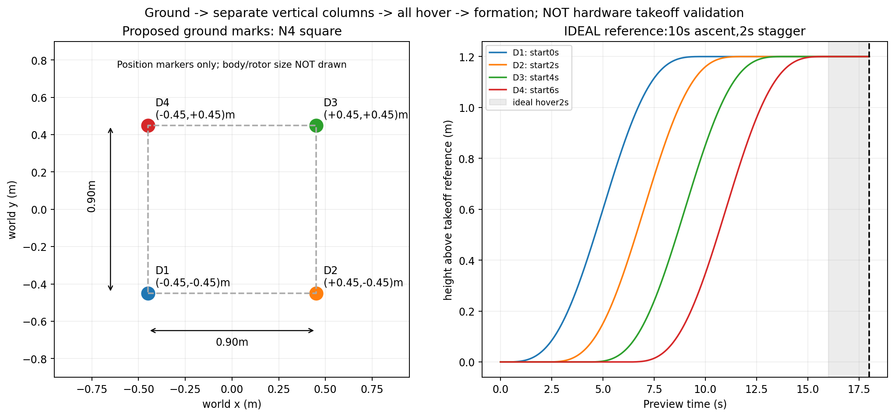
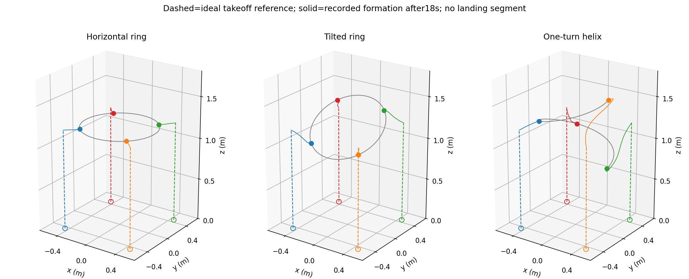

# TDFC 四机接入准备（实验性、仅观察）

本包将已完成数值验证的曲线控制器迁入机房 ROS 2 Humble 工作区。它包含水平圆环、倾斜圆环、单圈螺旋线三个四机场景；暂不扩展六/八机。

**当前版本不会起飞、不会连接无线电，也不会发布飞机控制话题。** `tdfc_observe` 只订阅状态，并发布 `/tdfc/candidate/<机器人名>/cmd_full_state` 供检查。不要把候选话题重映射至飞机话题：FullState 接口转换、速度环、测量延迟和返航降落尚未真机验证。算法输出的数值回归与 ROS 真机闭环验证是两件事。

## 目录与来源

- `tdfc_lab/research/`：2026-11-01 从研究工程复制的 Python 源码及 ORCA C++ 包装；`SOURCE_MANIFEST.json` 记录原始逐文件 SHA256。
- `third_party/RVO2-3D/`：上游 ORCA 源码与许可证，重新在目标机编译，不拷贝 macOS 二进制。
- 唯一研究源码适配是 `orca_adapter.py` 的共享库路径；算法数值逻辑未改。
- `config/tasks.json`：已冻结的三场景参数。0.3 m/s、1 m/s²、0.5 m 间距、0.08 m 预留、0.1 s 速度环均为数值实验配置，尚未标定为硬件参数。
- `config/crazyflies_four_candidate.yaml`：只启用 cf5–cf8，0.9 m 正方形地面摆位草案。保留原主配置不变。机体身份、场地坐标及 marker 必须实际核对；该文件不是飞行许可。
- `docs/LAB_REVIEW_CN.md`：机房静态检查；另外两份日期文档是历史研究依据，原绝对路径和旧状态保留，当前部署状态以本文为准。

## 本机离线验证（不需要 ROS）

在仓库根目录，用已安装 NumPy、SciPy 的 Python：

```bash
sh tdfc_lab/scripts/build_offline_orca.sh
PYTHONPATH=tdfc_lab python3 -m unittest discover -s tdfc_lab/test -v
PYTHONPATH=tdfc_lab python3 -m tdfc_lab.offline --shape ring --steps 200
PYTHONPATH=tdfc_lab python3 -m tdfc_lab.offline --shape tilted_ring --steps 200
PYTHONPATH=tdfc_lab python3 -m tdfc_lab.offline --shape helix --steps 200
```

13 项 unittest（其中一项覆盖三条轨迹），三份轨迹各 200 步，共 2400 次 ego 调用，与原归档速度命令逐位一致；不是重新跑出的替代真值。回归夹具是原轨迹首 4 s，不代表全部运行或真实飞行。独立的三个 4 s 冒烟运行检查原速度环模型的步内间距、有限性及速度限幅。结果见 `docs/OFFLINE_VERIFICATION.json`。

## 机房编译与只读观察

地面摆位与路径参考如下：虚线起飞部分是理想参考，实线是既有形成仿真，不是完整起降闭环或实飞机录。返航与降落仍待设计。





在已经安装 ROS Humble/Crazyswarm2 依赖的 Linux 工作区执行：

```bash
source /opt/ros/humble/setup.bash
cd ~/ros2_ws
colcon build --symlink-install --packages-select tdfc_lab
source install/setup.bash
# 前提：已有系统正在按核实后的配置提供 odom；本命令不启动服务器或飞机。
ros2 run tdfc_lab tdfc_observe --ros-args \
  -p shape:=ring \
  -p robot_names:="['cf5','cf6','cf7','cf8']" \
  -p expected_frame:=world \
  -p log_path:=/tmp/tdfc_ring_candidate_001.jsonl
```

可将 shape 改为 `tilted_ring` 或 `helix`。日志以排他模式新建，防止覆盖上一次结果；再次运行需更换文件名。这里不提供自动起飞 launch，避免误启动十机默认配置或旧脚本。

ROS 运行和 colcon 编译需要在机房验证；开发机只有 Python/C++ 离线检查，不能把其结果写成 ROS 集成已通过。

## 状态、时间和控制语义

机器人按 YAML 名称映射，不从 URI 推算 `/cf10` 等话题；cfA 仍为 cfA。状态缓存以四机最新可用时刻的最小值为共同时间，用历史样本插值对齐，不用未来样本。每个 ego 另外只接收自身最新速度和时间。

决策采用固定 20 ms 逻辑时间网格；错过周期、时钟跳变、超过草案 5 ms 调度偏差、错误坐标、陈旧数据或算法异常均锁止候选输出并记录原因，不伪造“安全零速度”。初始等待四机齐全。某机不再更新后，现有状态仅可在年龄门槛内使用，超过后锁止。

当前 server 的 odom header 是主机接收时间，并非真实测量时间，因此缓存的年龄不包含未知的动捕/无线延迟。0.1 s 观测年龄、0.04 s 自身回传年龄只是观察阶段草案；0.04 s 与原离线“新鲜本机速度”假设不同，不能沿用原安全证书。实际速度值是否处于世界坐标仍需核对固件。

冻结控制器输出**速度设定值**；候选 FullState 的位置为预测当前位置加一个周期的设定速度，acc 为 `(设定速度-本机测量速度)/dt`。它不是原物理模型中的实际加速度，也可能大于 1 m/s²。该消息用于检查接口，不是可直接转发的飞行参考，更不能借此声称硬加速度约束已实现。所有候选日志都声明 `safety_certificate_applicable=false`。

## 可移植回放格式

```bash
PYTHONPATH=tdfc_lab python3 -m tdfc_lab.offline --shape ring --replay aligned.npz
```

NPZ 不允许 pickle；必须包含 `agent_ids`（4 个字符串），`position`、`velocity`、`own_velocities`（K×4×3），`measurement_time`、`decision_time`（K），`own_times`（K×4）。位置和速度已经按共同测量时间对齐，时间单位秒、长度米、坐标 world Z-up。可选 `expected_command`（K×4×3）触发 1e-9 数值一致性检查。格式错误、陈旧/未来帧和非 20 ms 决策间隔会报错。原归档夹具的自身速度使用数值模型真值，仅用于迁移回归；不能把实测 ROS 接收速度称为无延迟真值。

## 真机接通前剩余工作

1. 确定四架机体、动捕身份、房间可用边界和起降柱，核实坐标/速度单位/marker 偏置。
2. 采集状态记录，保留固件采样时间、主机接收时间，标定速度环与年龄门槛。
3. 用录包驱动候选节点，验证实际频率、数据中断和调度开销。
4. 明确 FullState 参考生成与闭环跟踪策略，先验证单机，再完整四机任务仿真。
5. 新增受反馈监管的起飞—悬停—控制接管—返航至分离降落柱—降落状态机，以及服务完成/有效期处理和异常策略。`emergency` 只作为明确的停电机操作，不能替代正常降落。

实飞按水平圆环→倾斜圆环→螺旋线推进，所有正式尝试、失败和中止都记录。当前实飞次数仍为 0。
